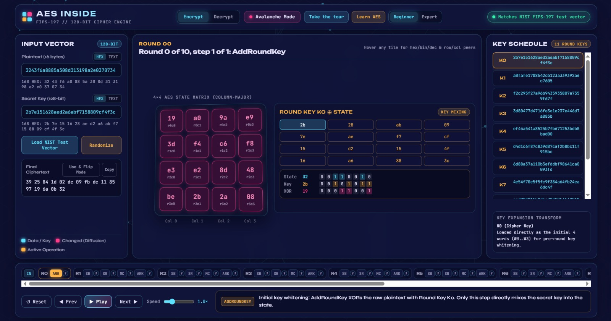

<div align="center">

# AES Inside

### An interactive, round-by-round visualizer of the AES-128 cipher

Watch 128 bits get scrambled, one operation at a time, and see why a single flipped bit changes about half the output.


**[Live demo](https://YOUR-SITE.netlify.app)** · 


 
 

</div>

---

---

## About

**AES Inside** is a browser-based simulator that opens up the Advanced Encryption Standard (AES-128, NIST FIPS-197) and shows every intermediate state of the cipher. It was built as a Cryptography and Information Security project to turn an abstract algorithm into something you can watch, step through, and break apart.

The AES engine is written **from scratch in plain JavaScript, with no cryptography libraries**. Every byte shown on screen comes from that engine, so what you see is the real computation and not a mock-up.

There is no build step, no backend and no framework. Open `index.html` and it runs.

## Features

### Cipher visualization
- **4×4 state matrix** that updates after every operation, with changed bytes highlighted.
- **SubBytes:** a 16×16 S-box grid where the looked-up cell lights up, with a beam tracing each byte from the state to its S-box entry.
- **ShiftRows:** each row is labelled with its shift amount, and bytes that wrap around the edge are highlighted.
- **MixColumns:** the fixed matrix multiplication for any chosen column, plus a popover showing the exact GF(2⁸) arithmetic.
- **AddRoundKey:** the round key beside the state, with the XOR of any selected byte shown bit by bit.
- **Key schedule panel:** all 11 round keys (K0 to K10). Selecting one shows its RotWord, SubWord and Rcon derivation.
- **Hover inspector:** hover any byte to see its hex, binary and decimal values, with lines to the other bytes in its row and column.

### Encrypt and decrypt
- Full AES-128 encryption and decryption, built from the inverse operations.
- Hex or text input for both the plaintext and the key, with a "Randomize" button.
- A one-click **NIST FIPS-197 test vector** and a live verification badge.
- "Use & Flip Mode" feeds the output back in so you can see the round trip.

### Avalanche mode
- Flip **any single bit** of the plaintext or the key, using a 128-bit selector or a random flip.
- Two states side by side: the original and the one-bit-changed run.
- A live counter of differing bits and bytes, a per-round line chart (with the 64-bit / 50% target marked) and a round-by-round byte heatmap from R0 to R10.

### Built-in tutorial
- **Spotlight tour:** a 7-step guided walkthrough of the interface that starts on the first visit.
- **Learn AES:** an 8-chapter read-along drawer. Each chapter drives the simulator to the matching step.
- **Contextual help:** a `?` beside every operation in the timeline opens a short explanation and its formula.
- **Beginner / Expert toggle:** Expert mode adds the underlying maths (GF(2⁸), the reduction polynomial, S-box construction, Rcon).

### Interface
- Step forward and back, auto-play with a speed slider, and jump to any operation from the timeline.
- Animated boot sequence, an interactive network background that reacts to the cipher steps, and a responsive layout.
- Keyboard accessible, with focus trapping in the tour and ARIA labels. Respects `prefers-reduced-motion`.

## How AES works (in brief)

AES-128 encrypts a 16-byte block with a 16-byte key. The block is arranged as a 4×4 grid of bytes called the **state**, filled column by column. The key is expanded into **11 round keys**.

| Step | What it does | Security role |
|------|--------------|---------------|
| **AddRoundKey** | XORs the state with the current round key. | The only step that uses the secret key. |
| **SubBytes** | Replaces every byte using a fixed 16×16 S-box. | **Confusion:** a non-linear step that hides the key–ciphertext relationship. |
| **ShiftRows** | Rotates row *r* left by *r* bytes. | **Diffusion:** spreads bytes across columns. |
| **MixColumns** | Multiplies each column by a fixed matrix in GF(2⁸). | **Diffusion:** every output byte depends on all four input bytes of the column. |

The schedule is:

```
Round 0        AddRoundKey
Rounds 1 to 9  SubBytes → ShiftRows → MixColumns → AddRoundKey
Round 10       SubBytes → ShiftRows → AddRoundKey      (no MixColumns)
```

Round 10 skips MixColumns because the step has no key, so adding it at the very end would not improve security.

Decryption applies the inverse operations in reverse order. Together, the rounds produce the **avalanche effect**: flipping one input bit changes roughly half of the output bits.

## How the simulator works

1. `aes.js` runs the full cipher and **records the state after every operation** as an array of steps. For AES-128 that is 40 steps. Each step stores the round, the operation, the state before and after, the round key, which bytes changed, and a plain-English caption.
2. `app.js` never recomputes anything while you play. It **replays the recorded steps** and animates them. That is why stepping backwards, jumping to any point and scrubbing the timeline are all instant.
3. In avalanche mode the engine runs twice, once on the original input and once with one bit flipped, and the interface compares the two recordings step by step.

## Getting started

No installation is needed. You only need a modern browser.

```bash
git clone https://github.com/YOUR-USERNAME/aes-inside.git
cd aes-inside
```

Then either:

- open `index.html` directly in your browser, or
- serve the folder locally, for example with the VS Code **Live Server** extension or:

  ```bash
  python3 -m http.server 8000
  # then visit http://localhost:8000
  ```

The display fonts (Unbounded, Syne, JetBrains Mono) are loaded from Google Fonts. Offline, the page falls back to system fonts and everything still works.

Built and tested in Google Chrome.

## Project structure

```
aes-inside/
├── index.html     Page structure and all UI containers
├── style.css      Theme, layout, animations, tutorial styles
├── aes.js         AES-128 engine: key expansion, encrypt, decrypt, step recording, self-test
├── network.js     Interactive network background and cipher-step pulses
├── tutorial.js    Spotlight tour, Learn AES drawer, "?" help, Beginner/Expert content
├── app.js         UI controller: rendering, playback, avalanche mode
└── README.md
```

All tutorial text lives in the `TUTORIAL_CONTENT` object at the top of `tutorial.js`, so it can be edited in one place.

## Controls and shortcuts

| Action | Control |
|--------|---------|
| Play / pause | `Space` |
| Next step / previous step | `→` / `←` |
| Jump to any operation | Click it in the timeline |
| Inspect a byte | Hover a tile |
| Inspect MixColumns arithmetic | Click a column in the grid or a column pill |
| Inspect an XOR in AddRoundKey | Click a byte in the round key grid |
| Tour: next / back / close | `Enter` or `→` / `←` / `Esc` |

## Verification

The engine checks itself against the official NIST FIPS-197 (Appendix B) test vector when the page loads, and the status badge in the top bar shows the result.

| | Value |
|---|---|
| Plaintext | `3243f6a8885a308d313198a2e0370734` |
| Key | `2b7e151628aed2a6abf7158809cf4f3c` |
| Expected ciphertext | `3925841d02dc09fbdc118597196a0b32` |

The badge turns green and reads "Matches NIST FIPS-197 test vector" when the computed ciphertext matches. For any other input it checks that decrypting the output returns the original block.

## Deployment

This is a static site, so it deploys anywhere that serves files.

**Netlify**
1. Push the repository to GitHub.
2. In Netlify, choose **Add new site → Import an existing project** and pick the repository.
3. Leave the build command empty and set the publish directory to the repository root (`.`).

GitHub Pages and Vercel work the same way.

## Limitations and educational scope

AES Inside is a **teaching tool**, not a security product.

- It encrypts a **single 16-byte block** with AES-128. It does not implement modes of operation (CBC, CTR, GCM), padding schemes, or AES-192/256.
- The implementation is written for clarity and for exposing intermediate states. It is not hardened against timing or side-channel attacks.
- Do not use it to protect real data. Use a vetted library such as the Web Crypto API for that.

## Roadmap

- AES-192 and AES-256 key sizes
- Block cipher modes (ECB vs CBC) with the classic image-encryption comparison
- Export of a full run as JSON or CSV
- A side-by-side "compare two keys" view

## Acknowledgements

- [NIST FIPS-197](https://csrc.nist.gov/publications/detail/fips/197/final): the Advanced Encryption Standard specification.
- Designed and developed with the help of AI tools as part of a Cryptography and Information Security course project. The cipher engine was verified against the official test vector, and the author is responsible for understanding and explaining the code.


---

<div align="center">

Built by **Swarali Nasikkar** · [GitHub](https://github.com/SwaraliNasikkar) · [LinkedIn](https://www.linkedin.com/in/Swarali Nasikkar)

</div>
